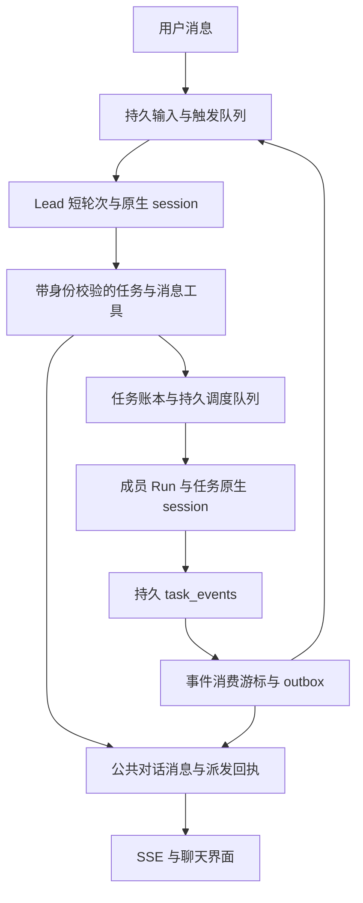

# RIFT 对话协作优化开发方案

日期：2026-10-26。状态：**C1–C4 已实现，新模式默认开启**。适用范围：工作区聊天、Lead 编排、成员间消息、任务事件回流，以及 Codex 原生会话续接。实现、分层验证与具体限制见 [C2–C4 验收](collaboration-acceptance.md)；第一阶段记录保留为历史。

后续 [工作区仓库权限更新](workspace-repository-permissions.md) 已调整运行边界：Host 授予全部已关联仓库与精确 Git 元数据，普通讨论/开发允许本地提交；正式 review/analysis 仅 Host read/list 与协作工具、无原生 shell，避免只读 shell 的 loopback 副作用。cwd、仓库集合或权限版本变化时旋转 thread，并从 Host 证据恢复上下文，同边界继续复用。网络与远程发布验收按该文档单独记录，不由 C1–C4 历史通过结果推导。

本文承接 [UI 开发计划](ui-gap-analysis-and-plan.md)和已实现的 [Codex 原生持久会话](native-sessions.md)。目标是把“用户发出需求后，Lead 长时间显示正在回复”改为可持续交互的协作过程：**Lead 用短对话轮次理解需求、录入和派发任务；任务在后台执行；关键事件回到对话，并触发下一次必要的协调。**

## 1. 需求与完成边界

用户应当能够在一个 workspace 的对话中完成以下过程：

1. 输入自然语言需求，Lead 理解目标，必要时澄清；满足执行条件后，创建可追踪的 Workflow 和 Task。
2. Lead 主动向指定成员分配任务，在对话中展示真正关联任务的 `@成员` 消息和派发回执。
3. 首次派发后结束当前回复，任务继续运行；用户仍能发送消息、查看进度或停止指定操作。
4. 成员在同一对话中报告关键进展、问题和结果；成员之间可以定向询问或补充信息。
5. 开发完成后继续检查、审查、必要的返工和集成；Lead 在需要决策时自动续接自己的会话。
6. 最终回复引用实际验收结果；刷新、断线、Host 重启后仍可追踪消息、任务和执行状态。

本期继续使用现有 RIFT 账本、调度器和 Codex app-server 持久 thread，不以引入 LangGraph 为前提。聊天 thread 与任务 thread 继续分开；跨成员协作通过明确消息和结构化结果交换上下文，不共享完整原生历史。每条定向消息先支持一个接收者，多人广播暂不纳入首版。

## 2. 开发前基线与问题定位

### 2.1 实施前确认的代码行为（历史基线）

下表记录制定方案时的问题；当前实现已采用短轮次、持久协作消息与安全正文前缀流。运行时当前用户输入为原文，历史和成员消息以短来源说明保留身份，工具调用继续结构化。

| 位置 | 当前行为 | 对体验的影响 |
| --- | --- | --- |
| [ChatService.execute](../src/chat/service.ts) | `onText` 只追加到 `bufferedText`；等待模型结果和 `dispose()` 后，才写入 `message_chunks`、回复和最终状态 | 模型中间输出不可见；长轮次和清理等待都可能表现为“正在回复” |
| [HostService.chatTools](../src/api/host-service.ts) | Lead 可以录入计划、派发、重试和请求集成，也能调用阻塞的 `rift_wait` | Lead 可能在同一聊天轮次中反复等待整个任务流程 |
| [HostService.ensureLead / startLead](../src/api/host-service.ts) | 建立 DSH Lead 身份与启动其模型执行是不同操作；聊天创建 Workflow 使用 `startLead: false` | 有后台父 Agent 身份不等于已经建立自动续办循环 |
| [聊天契约](../src/chat/contracts.ts)、[UI 账本迁移](../migrations/0004_ui_domain.sql) | 消息只有 user/assistant 和 `recipientAgentId`；一个聊天 Turn 关联一条输入消息 | 尚不能准确表达成员发给成员、系统回执和事件触发轮次 |
| [ChatScreen](../ui/src/ChatScreen.tsx) | 用户可以通过 @ 选择接收者；助手作者也由接收者推导 | 用户 @ 路由已经存在，Lead 主动发送协作消息的契约仍缺失 |
| [任务协调器](../src/task/coordinator.ts)、[工作区事件](../src/events/workspace-events.ts) | 已有持久 `task_events`、状态查询和 UI SSE 投影 | 缺少事件到聊天消息、再到 Lead 新轮次的可靠消费链路 |

这些事实说明了造成长时间无反馈的结构性原因，但**尚未取得用户本次异常 Turn/Run 的现场记录**，不能断言这一次一定卡在 `rift_wait`。实施前需要区分模型未结束、工具等待、工具异常和清理停滞。

正文暂存还承担了完整文本脱敏：凭据可能跨多个模型 delta。不能通过直接广播原始 delta 来解决体验问题。

### 2.2 先补充的诊断数据

为 Turn 保存并向 UI 投影以下信息，日志不包含原始凭据、完整工具参数或原生私有历史：

- 当前阶段、阶段开始时间、最后一次模型事件时间、最后一次有效进展时间。
- 当前工具名、工具调用 ID、开始/结束时间，以及已提交的 request/task/run 引用。
- runtime 启动、模型终止、清理开始、清理确认或未知状态的时间。
- 既有 native session/thread/turn 映射、关联 Workflow、待处理触发数量。

“进程仍存活”与“业务有新进展”分别计时。只收到心跳不能一直重置无进展提示。已有卡住的执行先通过这些证据定位；升级不强制释放其未知 lease，也不自动重跑原指令。

## 3. 目标交互

以下为目标体验示意，不是现有执行记录。括号中的来源必须由 UI 明确区分。

| 时机 | 对话中可见内容 | 实际状态 |
| --- | --- | --- |
| 用户发送 | “实现登录校验，并补充边界测试。” | 用户消息已保存，Lead 排队或开始理解 |
| Lead 录入 | “拆成两个任务：实现校验、补充测试。” | 只有工具提交成功后，才展示已创建的任务卡片 |
| Lead 派发 | “@开发 A 负责校验；@开发 B 补充测试。” | 两条定向派发消息分别关联 Task、接收成员和 request |
| Host 回执 | “任务已入队；开发 B 等待前置任务。”（系统） | 入队不等于已开始；依赖与成员占用原因可展开 |
| Lead 首轮结束 | “任务已登记并派发，后续结果会更新到这里。” | 模型轮次结束并清理确认后释放 Lead lease |
| 成员进展 | “发现调用方还依赖旧格式，@Lead 请确认兼容范围。”（成员） | 当前 Run 发布消息，不额外启动自己的聊天 Turn |
| 开发结束 | “开发结果已收集，等待检查与审查。”（系统） | 不把开发 Run 完成表述为任务验收通过 |
| 审查拒绝 | 展示真实审查结论和候选提交；Lead 分配返工 | 新 attempt 遵守修复次数、清理和角色约束 |
| 最终收尾 | Lead 汇总已接受提交、检查与审查证据 | `workflow.completed` 与真实门禁一致 |

用户中途补充要求时，消息立即保存并显示队列状态。Lead 当前轮次结束后再处理；首版不向正在运行的 Codex turn 注入未经确认支持的实时 steering。要求改变任务范围时，Lead 使用已有重规划或取消/返工机制，不能改写正在执行的不可变输入快照。

## 4. 执行架构



### 4.1 三种生命周期分别表达

保留已有 `AgentTurn.status` 和任务状态枚举，增加阶段及等待原因投影，不用前端文案替代真实生命周期。

| 对象 | 建议表达 | 结束条件 |
| --- | --- | --- |
| 聊天 Turn | 排队、启动、理解/生成、调用工具、交接中、清理中、完成/失败/取消/中断 | runtime 已终止；lease 是否可释放另外由 cleanup 决定 |
| Task / Run | 排队、等待依赖/成员、开发、检查、审查、返工、接受、阻塞 | 继续由现有业务状态机和门禁决定 |
| 协调触发 | pending、claimed、consumed、failed、interrupted | 一次协调决策及其结果被记录；未知执行不可直接退回 pending 重放 |

首轮不等待开发任务完成，但也不能提前把仍在运行的原生 turn 标成 completed。模型完成后清理未确认时显示“回复已结束，清理待确认”，保留占用。停止当前回复仅影响该 Turn；取消 Task 或 Workflow 使用各自已有入口。

### 4.2 单一协调入口

为每个 Workflow 持久记录协调归属和主对话 `conversationId`。聊天创建的 Workflow 由该对话中的 Lead 负责决策；其他对话可引用它，不自动复制一份后台 Lead。

所有用户驱动、事件驱动和手工唤醒的 Lead 决策都经过同一持久队列，并同时遵守：

1. workspace 的 Lead 执行 lease；同一成员聊天/任务不能并发占用。
2. Workflow 的协调所有权和版本校验；任何编排写工具都校验当前合法决策执行。
3. 已有任务、Run、队列和集成幂等约束。

`ensureLead()` 可继续提供 activation bridge 所需的 DSH live parent 身份，但该身份不能同时在另一条 followup 循环中独立决策。`startLead()` 和 CLI `lead` 对已启用新模式的 Workflow 应转为入队唤醒。迁移阶段可保留旧模式，但同一 Workflow 只能选择一种模式；未知清理或在途旧 Lead 阻止切换。

## 5. 短轮次与交接协议

### 5.1 Lead 一轮的职责

一轮只处理一个明确触发或一个合并后的事件批次：读取当前状态、作出有限决策、提交任务/消息、返回回执或结论。完成当前批次可派发的独立任务后交接，不能在聊天里循环等待所有任务完成。

对新模式聊天 Lead 移除 `rift_wait`，保留有界、非阻塞的 `rift_status`。旧 CLI 模式的工具兼容由协调模式决定，不能只修改提示词而继续暴露无限等待路径。

新增 Host 管理的交接记录，建议工具名 `rift_yield`：

- 输入为本轮回执引用和简短说明；Host 核对任务/操作归属并保存 `handoff_requested`。
- 若仍有未完成 Workflow，必须已存在持久事件订阅/续办归属，才能确认交接可继续。
- 返回已登记的任务、队列和后续触发方式，要求模型完成本轮最终回复。
- `rift_yield` 不等于原生 `turn/completed`，不直接释放 lease，不以清空 UI 状态代替清理。
- 交接后不再接受本轮新的编排写入；若模型仍循环调用工具，记录协议违规并按轮次预算停止，显示取消/失败而非伪造成功。已提交的业务操作仍保留。

提示词只是辅助。Host 还需限制单轮工具调用数、总时长、重复无进展调用，并记录触发的限制原因。建议先增加可配置的无进展提示阈值，沿用现有硬超时基线收集数据，再确定更短预算；不把外部模型首 token 时间承诺为固定几秒。

### 5.2 首阶段必须具备最小续办

**不能在移除 `rift_wait` 后，仅返回“已派发”就结束开发。** 首阶段至少要持久记录 Workflow 与来源对话关系，并在开发结果可集成、任务阻塞、审查拒绝、接受和清理恢复等必要事件后，排队唤醒 Lead。

最小续办可以先只使用系统回执和 Lead 后续回复；第二、三阶段再补齐成员定向消息、进展合并和完整恢复能力。新模式默认开放的前提是首轮结束后，任务能够持续走到验收或明确阻塞。

## 6. 持久化契约

以下为完整目标契约。第一阶段已使用增量迁移 0012/0013 实现 Workflow 主对话、Trigger、消费游标、outbox、协调决策、独立系统回执和 Turn 活动；消息 sender/recipient 扩展与成员 inbox 仍待 C2，不能把表中全部字段视为已交付。已有 0001–0011 保持原样。

### 6.1 消息、触发与活动

| 实体 | 建议字段/约束 | 用途 |
| --- | --- | --- |
| `messages` 扩展 | `sender_type: user/agent/system`、可空 `sender_agent_id`、可空 `recipient_agent_id`、`kind`、`origin`、`visibility` | 分开发言者、接收者和来源；公共展示与内部触发分离 |
| 消息关联 | `workflow_id`、`task_id`、`run_id`、`source_turn_id`、`request_id`、`reply_to_message_id`、`correlation_id`、`dedupe_key` | 追踪派发、回复与实际执行；按 workspace 范围校验关联对象 |
| `workflow_conversations` | Workflow 唯一主对话、协调模式、版本和建立时间 | 确定自动汇报与 Lead 续接位置；其他对话仅通过引用关联 |
| `turn_triggers` | 目标成员/对话、类型、来源消息或事件集合、因果链、状态、去重键、重试信息 | 支持 user_message、agent_message、task_event、manual_wake，不伪造用户消息 |
| `agent_turns` 扩展 | `trigger_id`、可空的旧 `message_id`、阶段、阶段时间、最后进展时间、交接状态 | 保留用户输入轮次兼容；事件轮次直接关联 Trigger |
| `turn_activities` | Turn、单调序号、工具调用 ID、类型、阶段、时间、脱敏摘要和实体引用 | 即时展示真实工具动作，不依赖模型正文流 |
| `agent_inbox` | 消息、接收成员、目标 task/thread 范围、投递状态、消费执行 ID、去重约束 | 成员忙碌时可靠等待；区分已存入、已投递和已消费 |

`kind` 首版建议为 discussion、delegation、receipt、progress、result、blocker。`origin` 区分用户输入、模型生成和 Host 事件投影；系统投影的“开发完成”不能冒充开发成员亲口说出的消息。

旧表的 `role` CHECK、非空接收者以及 `agent_turns.message_id` 的唯一/外键约束需要一并迁移。旧 user 消息回填 sender=user；旧 assistant 消息可由其历史接收者回填 sender_agent_id。兼容字段不能继续成为新消息作者的判断依据；迁移必须验证历史 reply-to、chunks、Turn 和 receipts 的引用完整性。

自动触发无需创建一条假的用户消息。`turn_triggers` 保存内部触发；可展示的事件回执仍是独立公共消息。旧 message_id 仅在用户/成员消息触发时保留，新查询不得假定每个 Turn 都有用户气泡。

### 6.2 事件消费与决策

| 实体 | 最低要求 |
| --- | --- |
| 持久消费游标 | 记录消费者和最后扫描的 `task_events.event_seq`；与 outbox 写入同事务推进 |
| 协作 outbox | 保存来源事件、目标对话、输出种类、payload、状态、attempt、下次重试时间；对事件＋目标＋输出种类建立唯一约束 |
| 协调决策记录 | Workflow、触发批次、Lead Turn、执行归属、计划版本、结果及清理状态；同一 Workflow 同时最多一个有效决策 |
| 业务幂等记录 | 同一操作键和相同规范化输入返回原回执；相同键不同输入报冲突；覆盖模型工具调用后的重试窗口 |

事件投影使用至少一次处理与去重后的可见结果。SQLite 内事务可以保证相关记录一致；SQLite 与 app-server、Git 或外部模型之间不宣称端到端 exactly-once。

## 7. 工具与 API 设计

### 7.1 主动派发：`rift_delegate`

由 Lead 使用，把“指定成员承担任务”变为业务命令。建议输入采用互斥结构：

| 输入 | 含义 |
| --- | --- |
| `taskId + expectedTaskVersion` | 派发当前 Workflow 中已有任务 |
| `taskDraft + expectedPlanRevision` | 在当前 Workflow 中追加一个任务；包含 kind、title、instructions、repositoryId、expectedPaths、acceptanceCriteria、dependsOn 等已有计划字段 |
| `recipientAgentId` | 明确接收成员；Host 验证其属于 workspace、已启用且具备任务绑定 |
| `message` | 给接收成员的任务说明；以模型来源派发消息保存 |
| `idempotencyKey` | 当前逻辑操作的稳定键；由调用上下文约束命名空间，重试不能换键 |

返回 `workflowId`、`taskId`、`requestId`、`messageId`、接收成员以及 `queued/waiting` 等真实派发状态。任务开始另由 Run 事件证明。

Workflow 建立可复用现有 `rift_workflow_start`。delegate 在已确定的 Workflow 中，将任务录入/版本验证、派发操作、协作消息与 outbox 意图放入同一 SQLite 事务；需重构现有协调器入口以共享事务，不能在多个外层 API 调用成功后假装原子提交。启动模型、创建 worktree 等外部操作在事务提交后由 worker 执行，事务内不进行网络或进程等待。

现有 `rift_plan_submit`、`rift_task_dispatch` 仍应产生同等回执，避免只有使用新工具才有聊天联动。多任务 DAG 可先提交完整计划，再逐任务 delegate；不新增一套绕开依赖、路径锁和门禁的调度器。

### 7.2 成员消息：`rift_send_message`

输入建议为 `recipientAgentId`、`content`、`kind`、可选 `taskId/replyToMessageId` 和幂等键。首版允许 discussion、progress、blocker 等协作类型；任务分配必须通过 delegate，验收结论必须来自实际业务门禁。

发送者、workspace、来源 Turn/Run、Workflow 和调用权限全部由 Host 推导，模型不能自行填写另一成员身份。每次调用校验活跃 lease、执行状态及对象归属，迟到工具回调不能继续写入。

不同调用场景的投递规则：

| 场景 | 处理 |
| --- | --- |
| Lead 发任务给成员 | 写派发消息并排任务；不为同一任务再创建一个竞争 lease 的成员聊天 Turn |
| 空闲成员收到询问 | 写 inbox，再排独立讨论 Turn；使用该成员的 conversation 原生 thread |
| 成员正在执行任务 | 消息保存并显示“等待成员处理”；不假装已经进入当前原生 turn |
| 当前 Run 主动报告 | 从当前 Run 的受限工具上下文直接写消息；不再启动自己的聊天 Turn |
| 任务相关补充信息 | 记录目标 Task，在下一次任务输入构建/返工边界按 receipts 注入；运行中的任务快照保持不变 |
| 需要立即回答的问题 | 排队等待可用执行；先做持久 inbox，不默认打断或 fork 当前 Run |

工具声明需接入相应运行时的正式任务工具面。Codex 自有 Provider 必须验证活跃 Run 到动态工具闭包的绑定；DSH 路径使用其现有作用域机制；未支持成员主动报告的 Provider 先显示真实系统事件，不能伪装其拥有工具能力。

### 7.3 对外 API 与 UI 契约

复用现有 workspace scoped 聊天、Turn、任务、状态和停止路由，扩展 DTO 返回消息作者/类型/业务引用、Turn 触发与阶段、活动序列和队列等待原因。具体路由沿用 [browser-service](../src/api/browser-service.ts)与 [host-service](../src/api/host-service.ts) 的接入方式，不增加绕过现有认证、归属和幂等校验的写入口。

UI 作者根据 sender 字段展示，接收者单独显示为 @ 标签；系统回执有独立标识。派发卡片可进入任务、Run 和证据页。停止回复、取消任务和取消流程使用不同按钮与动作说明。事件延迟或失联时保留最后已知状态并标注，不无限展示未验证的活动动画。

## 8. 事件回流与 Lead 自动续办

### 8.1 消费算法

1. 后台 worker 按持久游标读取 `task_events` 的有界批次；它不依赖浏览器打开，也不依赖有保留上限的 `workspace_events`。
2. 在同一事务中写消息/唤醒 outbox 意图并推进扫描游标。无关事件可以跳过，但必须推进到实际扫描位置。
3. 投影 worker 以唯一键生成公共消息；决策 worker 合并同一 Workflow 的可处理事件并建立 Trigger。
4. 取得协调归属和 Lead lease 后，读取**当前** Workflow/Task/Run/cleanup 快照，续接 Lead 原生 session，执行一轮有限决策。
5. 记录原生接收、工具回执和轮次结果；再提交触发消费状态。失败按已知/未知执行边界分类处理。

可见消息与唤醒是两个独立输出。某条进展只需要通知界面，不一定调用模型。任务先完成、首轮还未释放时，事件保持 pending；释放后合并消费，不丢弃也不并发启动第二个 Lead。

### 8.2 事件策略

| 来源事实 | 对话呈现 | 是否唤醒 Lead |
| --- | --- | --- |
| 派发入队、`activation_accepted` | 入队/已开始，附真实成员和 Run | 通常不唤醒 |
| 成员 progress | 合并后的阶段说明 | 通常不唤醒 |
| `source.collected` | 开发结果已收集，等待检查/审查 | 有可执行集成动作时唤醒；若清理未确认，等待对应恢复条件 |
| `task.blocked`、检查或审查失败 | 展示原因与证据引用 | 可返工/重规划或需用户决策时唤醒 |
| `integration.accepted`、分析 `task.succeeded` | 真实接受/分析完成状态 | 派发后继、汇总或收尾时唤醒 |
| `cleanup.confirmed` | 解除先前清理等待 | 存在因此受阻的动作时唤醒 |
| `publication.uncertain`、清理未知 | 明确恢复阻塞 | 通知一次并等待恢复，不反复要求模型重试 |
| `workflow.completed` | 最终状态及报告引用 | 已有本轮最终说明时不再递归唤醒 |
| 用户追问、成员 blocker/question | 显示原作者和关联任务 | 按优先级排队；不能抢占未知执行 |

表中的具体事件名称来自现有协调器；不存在独立事件的情况，实施时从实际结果/集成记录中归一化或增加明确业务事件，不能靠解析模型措辞判断成功或拒审。

同一 Workflow 的进展可在短时间窗口合并；用户输入优先于普通进展，阻塞和最终结果不能被进展流饿死。因果链保存 correlation ID、父消息和自动跳数，并设置连续自动消息/决策预算。单纯的“收到”、系统投影和自己的最终回复不触发无限互答；超过预算显示阻塞并保留待处理原因。

### 8.3 崩溃与恢复

- 写 task_event 后、写 outbox 前崩溃：从旧游标补扫。
- 写 outbox 后、投影消息前崩溃：重试 outbox；唯一键避免重复气泡。
- 消息写入后、确认投影前崩溃：再次处理返回原消息；唤醒用独立去重键。
- Trigger 领取后、确认没有发起 runtime 前失败：有明确未启动证据时可回队。
- 原生 turn 已接收或执行结果未知：标记 interrupted/unknown，保留 lease 和未确认触发，不自动重放工具副作用。
- Host 重启：允许恢复只读事件投影；执行恢复仍遵循现有暂停、live parent 和 cleanup 门禁。重新启用 Workflow 后再消费可执行 Trigger。

事件补投递与恢复执行必须分开。恢复消息成功不代表可以安全重跑开发或协调决策。

## 9. 原生 session 与上下文

继续使用已有会话范围：Lead/成员聊天按 conversation＋成员＋配置指纹；开发/返工按 task＋角色＋配置指纹；审查独立。事件唤醒 Lead 时在同 cwd/权限范围内回到原来的聊天 thread，不因每个事件创建新 thread。配置指纹包含权限版本、规范化 cwd 与全部已关联仓库；发生变化使用新 thread，以公共消息、previousResults、sourceEvidence 和 inbox 恢复必要上下文，不恢复旧私有历史。

需要同步调整 [native-sessions](../src/agent/native-sessions.ts) 与聊天输入构建：

1. 公共消息 envelope 增加 sender、origin、kind、reply-to、task/run 和来源事件；其他成员消息是带来源的协作数据，不能升级为用户或系统授权。
2. 将“最后一条当前用户消息”扩展为明确 Trigger：用户请求、成员请求或 Host 事件批次。对模型清楚说明本轮需要处理什么，不伪造用户发言。
3. 保留按消息 ID 的 receipts；增加事件触发消费映射。晚到的成员回复或系统结果仍能进入下一轮，不因最大 rowid 游标被漏掉。
4. 冻结本轮输入边界；开始后到达的用户消息和事件排到下一轮。自己的已完成回复继续标记接收，避免重复注入。
5. 任务 inbox 消息在下一次输入构建边界引用；公共聊天 thread 与任务 thread 之间只传递选中的消息及证据，不复制整份历史。
6. 保持现有未同步上下文超限时明确失败的行为；摘要或分页若另行实现，必须保留来源，不能静默标记未读内容已消费。

新增/调整动态工具声明会改变原生配置指纹，第一次升级可能创建新 thread；需要在版本说明中写明，并用公共消息和任务 envelope 初始化必要上下文，不能声称所有旧原生内部历史会自动迁入。对锁定 Codex 版本继续执行真实二进制协议探针，验证恢复后的工具声明与本次 Host 闭包绑定。

## 10. 实时反馈与传输

### 10.1 先交付活动，再开放正文流

第一阶段立即持久化和展示工具活动：调用开始、任务登记成功、派发入队、等待成员、工具失败、模型结束、清理阶段。活动摘要由 Host 从已提交事实生成，只含白名单字段；不能展示未提交的“已分配”。

正文流作为独立交付项：在保留尾部缓冲、跨 delta 脱敏、有界输入和异常终止规则后，才发布可确认安全的文本片段。无法证明安全的内容继续缓冲到结束。新增测试覆盖跨 chunk 的凭据和结构化内容；禁止先发送敏感文本，再依靠后续撤回补救。

草稿片段带 Turn 和单调序号；最终消息替换对应草稿，不能重复追加一次完整回复。取消或失败的草稿明确标注为未完成，不进入“已完成回复”的自动同步路径。

### 10.2 SSE 分页与重连

实现时修正并验证 [readWorkspaceEvents](../src/events/workspace-events.ts) 的游标契约：当前读取最多 100 条，但返回的是全局最大 seq。分页消费者不能把尚未交付的事件当作已经消费。

约定返回 `nextAfter` 为本页实际交付边界，另给 `highWatermark/hasMore`；无本 workspace 待发事件时可推进到同一快照中已确认扫描的上界。浏览器逐页追赶，并按实体 ID/version 或事件 seq 去重。超过保留窗口时请求一致快照后再续接，不能只把 cursor 跳到最新。

task_events 消费游标与 UI SSE 游标相互独立。聊天活动、任务消息和快照刷新走统一重连策略，覆盖并发其他 workspace、大于 100 条积压和历史消息分页场景。

## 11. 开发分期与改动地图

以下 C1.1–C4.2 均已实现。C1 证据见[第一阶段历史验收](chat-orchestration-acceptance.md)，C2–C4 证据见[最新验收](collaboration-acceptance.md)。本轮没有提交项目 Git；验收报告中的候选 SHA 来自独立临时仓库。

| 阶段 | ID | 工作与主要位置 | 完成门槛 |
| --- | --- | --- | --- |
| 第一阶段：短轮次可持续执行 | C1.1 | Turn 阶段/活动记录；`src/chat/service.ts`、runtime 回调、聊天 DTO、`ActivityTurn.tsx` | 可区分模型、工具、清理；真实回执在首轮结束前可见 |
| 第一阶段 | C1.2 | Workflow 主对话、最小 outbox/Trigger、统一 Lead 协调归属；`host-service.ts`、新协调队列模块、迁移 | 首轮结束后仍可自动走到验收或明确阻塞；UI/后台 Lead 无双重决策 |
| 第一阶段 | C1.3 | 新模式移除 wait、交接与预算；`chatTools`、`startLead`、`src/tools/rift-tools.ts` | 派发后不等待开发结束；停止、清理和未知占用语义正确 |
| 第一阶段 | C1.4 | 修正事件分页；`src/events/workspace-events.ts`、浏览器 SSE、UI 状态 | 积压和重连不漏掉回执与终态 |
| 第二阶段：成员协作 | C2.1 | sender/recipient、消息类型和业务引用；契约、迁移、`ChatScreen.tsx`、`MessageBody.tsx` | 主动 @、系统回执和模型发言归属准确，旧历史可读 |
| 第二阶段 | C2.2 | delegate 与旧派发回执统一；`host-service.ts`、`task/coordinator.ts` | 任务/派发/消息事务一致，重试无重复任务 |
| 第二阶段 | C2.3 | send_message、inbox、Run 内消息工具；`codex-provider.ts`、`native-codex.ts`、DSH 工具作用域 | 成员能提问/汇报；忙碌时明确排队，无同成员 lease 自锁 |
| 第三阶段：完整事件闭环 | C3.1 | 完善事件映射、合并、优先级、因果链预算；事件 worker 与协调队列 | 乱序、重复、返工和后继派发均正确；不无限互答 |
| 第三阶段 | C3.2 | 崩溃窗口、暂停/恢复、未知执行处理；恢复模块和持久队列 | 补消息不重放未知执行，清理前不释放占用 |
| 第三阶段 | C3.3 | Trigger 上下文、消息 receipts、原生续接探针 | Lead 续接、成员隔离、迟到消息和任务补充信息均有证据 |
| 第四阶段：正文流与发布 | C4.1 | 安全正文分片与草稿合并；运行时/聊天/UI | 脱敏不退化，片段与终稿不重复 |
| 第四阶段 | C4.2 | 端到端验收、运行诊断、使用和恢复文档 | 满足下节矩阵，分别记录受控运行与真实模型证据 |

第一阶段是一个完整的最小发布单元：C1.2 的最小续办必须与 C1.3 同时启用。第二、三阶段扩大交互与恢复覆盖，不能把所有自动续办都推迟到第三阶段。正文流未通过脱敏验证时，可先发布活动流和短轮次能力。

2026-10-26 状态回填：C1.1–C4.2 已实现，默认开启。聊天采用真实作者、独立 @接收者、消息下方任务 tag 深链与折叠进展；阶段开始/最后有效进展仅在活动详情页展示。真实拒审返工、并行成员消息、实二进制续接、事务/恢复故障和浏览器 P95 均有分层证据，具体覆盖边界见最新验收矩阵。

## 12. 验收与证据

### 12.1 功能和故障矩阵

| ID | 场景 | 必须观察到的结果 |
| --- | --- | --- |
| C-A01 | 用户一条可执行需求 | Lead 实际录入任务、指定成员、展示回执；没有把普通咨询强制转换成任务 |
| C-A02 | 开发 Run 持续十分钟 | 在受控 runtime 已结束 Lead 首轮并确认清理后，UI 独立进入首轮完成；开发继续，用户可发送下一条消息 |
| C-A03 | 两个成员并行且乱序结束 | 每条消息的作者/接收者/task/run 正确，结果不串线，后继依赖只在门禁满足后启动 |
| C-A04 | 重复 delegate、同键不同输入 | 同键同输入返回原 task/request/message；不同输入报冲突；无半条派发记录 |
| C-A05 | Lead 忙时收到多个事件和用户补充 | 消息先入账；后续按固定边界消费；一时刻最多一个合法 Lead 决策，无事件饥饿 |
| C-A06 | 成员在 Run 内汇报或接收询问 | 汇报不申请自己的第二个 lease；询问明确排队，在允许的输入边界消费 |
| C-A07 | 开发成功但检查失败、审查拒绝 | 对话不宣称接受；Lead 在现有预算内返工，新 attempt 续接对应任务 session |
| C-A08 | 最终接受与收尾 | 汇总引用 acceptedCommit/分析证据和检查审查记录；所有门禁通过才完成 Workflow |
| C-A09 | 刷新、断线、超过 100 条积压 | 活动/消息无重复或遗漏；保留窗口外用快照恢复；其他 workspace 不影响消费正确性 |
| C-A10 | outbox/消息/确认之间崩溃 | 补投递只得到一个可见结果，已提交任务不重复创建 |
| C-A11 | 原生接收后崩溃或清理未知 | interrupted/unknown 保留占用；恢复消息可进行，执行不被自动重放 |
| C-A12 | 模型不结束、工具挂起、dispose 超时 | 显示不同阶段、最后进展和可用停止操作；不靠页面超时伪造 completed |
| C-A13 | 停止回复、取消任务、取消流程 | 各自边界明确；迟到工具或事件不能重新派发已取消工作 |
| C-A14 | 跨 workspace、伪造作者或失效 lease | Host 拒绝写入；协作消息不会成为更高权限指令 |
| C-A15 | Lead/成员同权限范围跨进程续接、权限变化与迟到消息 | 同 cwd/仓库集合/权限版本续原 thread；变化则新建并用 Host 证据恢复；必要消息按 receipts 消费，未知接收边界明确报告 |
| C-A16 | 凭据跨正文片段、失败/取消草稿 | 持久消息、SSE 和 UI 均不暴露原值；终稿不重复，不把失败草稿记成完成回复 |
| C-A17 | 成员自动互答、重复普通进展 | 无无限唤醒；进展合并，因果链预算生效，阻塞信息可追踪 |
| C-A18 | CLI Lead 与聊天 Lead 同时唤醒 | 通过同一归属/队列串行决策；兼容模式不会双重运行 |

### 12.2 性能目标与测试层次

受控本机验收目标：数据库确认回执到 UI 可见的 P95 不超过 1 秒；健康 SSE 下模型终止且清理确认到 UI 终态的 P95 不超过 1 秒。两项均排除外部模型生成、任务执行和实际清理耗时，分别记录样本数及测试环境；轮询降级路径单独报告。核心判断是聊天轮次不再绑定开发耗时，而不是承诺模型在固定时间内理解所有需求。

先用受控 runtime、真实 SQLite 和事务故障注入验证状态机；用真实锁定 app-server＋本地受控 Responses 验证 session 和动态工具；最后在临时 Git 仓库跑真实模型的派发、拒审返工与收尾。三类结果分开记录，旧的 186/186 测试报告不算本优化的验收证据。

实现后的基础检查沿用现有命令：

```powershell
pnpm typecheck
pnpm test
pnpm build
pnpm exec tsx scripts/native-session-probe.ts
```

在 `tests/core`、`tests/acceptance` 和 UI 状态测试中补充上述有意义的并发、事务和恢复场景。建议新增专用验收报告与探针证据，记录运行模式、原生版本、真实/受控边界、失败和跳过项；不在开发文档中预填通过结果。

## 13. 上线与文档同步

1. 停止旧 Host 前等待可收束执行结束；备份 RIFT home、原生会话数据及相关仓库现场。未知执行按原恢复流程处理。
2. 应用增量迁移并运行历史数据兼容检查；已有活跃 Workflow 保留原协调模式，清理确认后才显式切换。新模式以单一配置开关同时启用短轮次和最小续办。
3. 先验证一个工作区的 Lead 派发、用户追问、拒审返工与最终汇总，再扩大启用范围。浏览器关闭时任务及事件 worker 仍继续工作。
4. 回退优先关闭新模式的新建入口，等待在途工作收束；保留新增账本，不直接删除迁移或让旧二进制读取未验证的新 schema。
5. 功能验收后更新 [UI 指南](ui-guide.md)、[原生会话说明](native-sessions.md)、[开发记录](development-status.md)、实施清单及新的验收报告，再将本文条目标记为完成。

当前交付记录见 [C2–C4 验收报告](collaboration-acceptance.md)。新模式默认开启，`RIFT_CHAT_ORCHESTRATION=0` 或 `chatOrchestration: false` 可关闭后续新建入口；已有 Workflow 保持原协调模式。迁移 0014/0015/0016 补齐消息身份与 inbox、安全流版本及因果链。2026-10-26 已构建并重启用户 Host；后续现场阻塞修复与验证见 [工作流恢复记录](blocked-workflow-recovery.md)。
