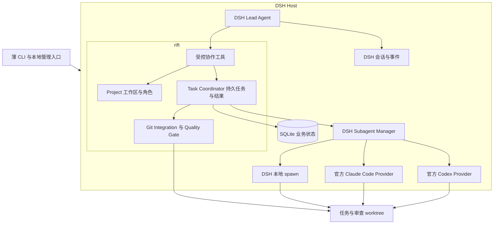

# RIFT 多智能体协作系统技术开发方案

版本：0.4。日期：2026 年 10 月 25 日。P0–P3 MVP 已验收；当前源码已继续实现 E1.1–E1.5，结果见 [E1 验收](e1-acceptance.md)。本文以下首版条款保留为 MVP 基线，新增契约以 [E1 指南](e1-guide.md) 为准：全局配额可配置、每工作区一个活跃 Workflow、任意角色与 purpose、原子重规划和公平调度、一次 analysis Run 内官方 Workflow 复用。E1.6 暂缓，本轮未使用 Claude。

RIFT 采用 **DeepSeek Harness 作为宿主与 Agent 内核，在其中加载一个 `rift` 插件**。插件只实现项目与角色、持久任务协调、Git 集成与质量门禁三个业务模块。Codex、Claude Code 的执行优先复用 DSH 官方 Provider，LLM API Agent 使用 DSH 本地 Agent。

插件标识、包名、工程目录和工具命名空间统一使用小写 `rift`；工具文件为 `rift-tools.ts`，业务数据库为 `rift.db`。

本方案依据已从浏览器完整读取的[多智能体架构设计原对话](https://chatgpt.com/g/g-p-6ab14a1b6be481919f8c7135baec3573-jevmo-xing-shi-yan/c/6add1b36-58f0-83e9-804c-25b1ed0c2494)中“能不能加入 deepseek harness 来减少需要开发的模块”之后的回答。原方案与本文的对应关系见[原方案对齐记录](source-alignment.md)。本文中的数据库字段、工具名、HTTP 路由和阶段验收是面向开发补充的 RIFT 契约，不是 DSH 已有接口。

## 1 产品目标与首版边界

完整产品目标保持为：管理多种运行时、多个逻辑工作区、工作区内的仓库 worktree，以及有主从关系的角色 Agent。每个角色保存其运行时配置。首版固定为 **一个 Lead、两个可并行的 Developer、一个 Reviewer**，实现并行开发、串行审查与集成。

RIFT 的概念是 **Parallel minds. One workspace.**：同一逻辑 Workspace 中，多个 Agent 在独立任务 worktree 内开发，成果通过质量门禁汇入同一集成分支。这里的 One workspace 指一次协作的共同项目上下文，不限制产品只能注册一个工作区。此决定替代 0.2 的串行开发 MVP，DSH 宿主与单插件边界保持不变。

| 能力 | MVP | 后续扩展 |
| --- | --- | --- |
| 运行时 | DSH 本地 Agent、官方 Codex Provider、官方 Claude Code Provider | 新增 Provider；确有需求时扩展原生会话与事件能力 |
| 工作区 | 可注册多个 Workspace，每个绑定一个仓库；全局一次运行一个协作流程 | 多工作区同时执行、多仓库任务 |
| 角色 | 一个 DSH Lead；两个 Claude Code Developer；一个 Codex Reviewer | 超过两个 Developer、自由角色组合、原生主 Agent |
| 任务 | 持久计划与基本 DAG 校验；独立就绪任务最多两个并行开发；审查排队 | 动态依赖重规划、复杂优先级与公平调度 |
| Git | Task attempt 独立 worktree、精确提交审查、串行集成 | 更复杂的并行冲突预测与跨仓库协调 |
| 恢复 | 保存业务事实；中断后检查修改并创建新 Run | 能力允许时恢复同一原生 Session |
| 交互 | DSH 协作工具与薄 CLI；必要的本地管理 API | SSE、Web UI、远程 Worker |

MVP 固定 DSH Lead 是原方案的阶段选择，不把“任意运行时担任主 Agent”误列为首版已支持。配置 schema 保留角色与 provider 的映射；MVP 对非 DSH Lead 返回明确的不支持错误。Codex 和 Claude Code 的角色长期存在，但一次 Task Run 使用一次性原生执行上下文。

部署以当前 Windows 环境优先，保持 TypeScript 业务代码可在 Linux 运行。初期单机、单用户，不引入 Redis、Kafka、分布式 Worker、前端或自动远程推送。用户当前检出的仓库分支保持由用户管理；系统成果落在 RIFT 集成分支。

## 2 复用边界与架构

### 2.1 直接复用的基础能力

| 能力 | DSH 入口 | RIFT 的责任 |
| --- | --- | --- |
| Agent Loop、工具、上下文压缩 | DSH Agent 与官方 profile 组合 | 定义角色 prompt 与业务输入 |
| LLM API 模型接入 | DSH 模型适配器，包括 DeepSeek 和多 Provider 路由 | 维护模型路由及凭据引用，验证实际服务 |
| Codex 执行 | `@deepseek-ai/dsh-subagent-codex` | 选择已注册 provider 实例、提供任务和 cwd |
| Claude Code 执行 | `@deepseek-ai/dsh-subagent-claude-code` | 同上，不另写 CLI 或 SDK 执行后端 |
| 子 Agent 启动、容量、取消、清理 | `@deepseek-ai/dsh-subagent` | 保存 Run 记录和 activation 关联，持有返回 handle |
| 单次执行内的并行与流水线 | `@deepseek-ai/dsh-workflow` 及其执行引擎 | 持久 Task 与 Git 验收；MVP 简单委派不强制使用脚本工作流 |
| 会话和原生事件 | DSH session、persistence、事件机制 | 保存引用和业务事件，不重写聊天历史 |
| 目录与 Session 登记 | `@deepseek-ai/dsh-workspace` | 额外保存逻辑 Workspace → Task → worktree 映射 |
| 文件和命令权限 | DSH 及外部 Provider 的原生策略 | 配置、实测和报告差异，不假设跨运行时完全等价 |

DSH Workflow 用于一次执行内的编排，不等于重启后可恢复的软件开发任务账本。官方文档建议一两个委派直接调用 subagent；MVP 使用此路径。后续需要批量分析时复用 Workflow，写代码的派发仍需先登记 Task/Run，不能绕过协调器。[Workflow 文档](https://github.com/deepseek-ai/deepseek-harness/blob/22ddee3792402c3e70ec5f86a63c3e3e895a2f60/packages/workflow/workflow/README.md)

DSH Workspace 管理目录与会话归属，不能直接代表一个逻辑项目下的多个任务 worktree。业务表保存两者映射，不修改 DSH 的登记语义。[Workspace 文档](https://github.com/deepseek-ai/deepseek-harness/blob/22ddee3792402c3e70ec5f86a63c3e3e895a2f60/packages/workspace/workspace/README.md)

### 2.2 三个业务模块



Project 负责工作区、仓库、集成分支、角色和 provider 配置映射。Task Coordinator 负责任务记录、执行资格、Run 关联、失败返工和重启恢复。Git Integration 负责 worktree、候选提交、测试、审查及串行合并。

协调器是 DSH Host 内的业务插件服务。它通过 DSH 启动 Agent，不实现另一套 Agent Loop、通用 RuntimeAdapter、独立进程监督器或原生协议客户端。薄启动器只启动/关闭选定的 DSH profile；不持有第二份任务状态。

### 2.3 实验性能力的采用规则

- Worktrees 插件作为 P0 对比项。它的创建操作还会切换调用 Session 的 cwd；这不适合直接拿 Lead 的 Session 为多个任务分配目录。MVP 默认使用插件内的薄 Git CLI 封装创建任务 worktree，并显式传递子任务 cwd。若 P0 找到不改变 Lead cwd 的可靠组合，可采用官方插件。
- Agent Teams 不作为业务调度核心。其具名成员、消息和任务板对本地 DSH Agent 有价值，但当前共享工作目录和可续写成员模型不满足本方案的异构单次 Provider 与独立 worktree 要求。
- 两者均不作为第一闭环的阻塞依赖，不 fork DSH 核心补齐产品功能。

依据：[Worktrees](https://github.com/deepseek-ai/deepseek-harness/blob/22ddee3792402c3e70ec5f86a63c3e3e895a2f60/packages/experimental/worktree/README.md)、[Agent Teams](https://github.com/deepseek-ai/deepseek-harness/blob/22ddee3792402c3e70ec5f86a63c3e3e895a2f60/packages/experimental/agent-team/README.md)。

## 3 工程组织与运行方式

### 3.1 工程结构

以一个插件包为主体，CLI、测试工具与 schema 保持在同一工程，达到实际规模后再拆包。

```text
rift/
  src/
    index.ts                  # Cordis 插件入口与依赖注入
    project/
      workspace.ts
      agent-roles.ts
      provider-bindings.ts
    task/
      coordinator.ts
      task-store.ts
      scheduler.ts            # MVP 就绪队列、双开发槽位与原子派发
      activation-bridge.ts    # 调用 DSH 服务的薄边界
      recovery.ts
    git/
      worktree-binding.ts
      integration.ts
      quality-gate.ts
    tools/
      rift-tools.ts
    api/
      local-api.ts            # 需要时挂载在同一 DSH Host 内
    cli/
      main.ts                 # 薄启动器与管理客户端
    contracts/
    storage/
  profiles/
  migrations/
  tests/
    contract/
    integration/
    e2e/
  package.json
docs/
```

TypeScript strict、ESM、Node.js 24 系列且满足所锁定 DSH 的要求、pnpm、Cordis、SQLite 与 Drizzle migration、schema 校验库、Vitest。CLI 可用 Commander；日志优先通过 DSH 已有日志设施。初版不需要大型 monorepo，也不把 Fastify、独立 Event Bus 或 SSE 作为闭环前置条件。

### 3.2 Host 和入口

P0 使用官方 SDK profile 或经验证的自定义 profile 装载插件，获得真实的 DSH Lead Agent。插件中的协作工具由 Lead 调用；工具执行上下文必须提供实际存活的 Agent 对象。具体 Agent 创建/恢复、工具注册、profile 装载和 context dispose 方式以锁定包的导出为准，P0 编译与 smoke 验证后写入兼容性记录。

POC 可通过官方 DSH SDK 将目标送入单个 Lead，验证完整流程。产品入口统一为薄 CLI 调用插件业务服务：`rift serve` 拥有一个 DSH Host 的启动与关闭，`rift run` 向该 Host 提交 Workflow；插件使用已验证的 DSH Agent API 建立或取得 Lead。不要让每个 CLI 命令重新启动一个共享同一业务库的 Host。SDK 的 idle 不等于业务 Workflow 已完成；结束条件为业务状态终态且相关 activation 已清理，等待期间必须保持 Host 和 Lead 存活。

Workspace 创建、查询、取消等确定性管理命令不能依赖额外调用模型。需要常驻管理入口时，由插件在同一 Host 内挂载最小 loopback API；薄 CLI 调用它。优先检查 DSH 的公开 Host 扩展入口，不能假定 stdio SDK 自动暴露插件方法，也不能调用不存在的 SDK `subagent/start`。若公开网关接入明显增加构建成本，可使用插件拥有的 Node HTTP listener，并在 context dispose 时关闭，记录此选择即可。

Host 启动取得单实例业务数据库锁，初始化迁移和恢复检查后才允许派发。插件卸载先阻止新任务，再 dispose 它持有的 activation，最后关闭 API 与数据库。复用 DSH 的原生清理，不另写一套正常执行路径的 OS 进程管理。

### 3.3 版本策略

调查源码固定为 `22ddee3792402c3e70ec5f86a63c3e3e895a2f60`，候选 DSH 版本为 `0.2.1-rc.3`；这不是已实测的部署组合。P0 锁定 DSH、Cordis、原生 Provider 和平台 payload 的实际兼容版本，核对 npm 发布包与源码差异。记录 OS、Node、provider 配置和真实 smoke 结果到 `docs/runtime-compatibility.md`。

DSH 仍为 developer preview。依赖升级必须回归插件加载、指定 cwd、结果、取消、权限和恢复路径。仅依赖包公开导出，不从内部源码路径 deep import；不自动升级到 latest。[DSH 仓库](https://github.com/deepseek-ai/deepseek-harness/tree/22ddee3792402c3e70ec5f86a63c3e3e895a2f60)

## 4 Provider 与角色配置

### 4.1 首个组合

| 角色 | 执行方式 | 首版职责 |
| --- | --- | --- |
| Lead | DSH 根 Agent 加配置的 LLM API | 规划、提交任务、请求派发、处理返工和总结 |
| Developer A（developer-a） | 官方 `claude-code` provider 实例 | 在任务独占 worktree 开发，与 Developer B 可并行 |
| Developer B（developer-b） | 官方 `claude-code` provider 实例 | 在另一任务独占 worktree 开发，与 Developer A 可并行 |
| Reviewer | 官方 `codex` provider 实例 | 审查固定候选提交，返回结论，不修改业务代码 |
| Tester | 后续可选 DSH `spawn` | 生成测试或分析失败；确定性测试执行本身无需模型角色 |

Role 保存角色名、prompt、provider binding、模型说明、权限和预算。Run 保存生效快照。ProviderBinding 只是对 DSH 已注册实例的映射，不是一个自研运行时管理系统。

### 4.2 静态实例与能力差异

外部 Provider 的 model、环境和 permissionMode 由实例配置决定，不能在每次 `startActivation` 中传入任意 `agentOptions`、`agentPreset` 或 `outputSchema`。需要同类运行时使用不同模型/权限时，在 profile 中注册不同 `providerName` 的实例，并在角色中引用。MVP 配置变化在安全停止并重启 profile 后生效，避免在途 Run 被热更新污染。

| 能力 | DSH 本地 spawn | 官方 Codex / Claude Code Provider |
| --- | --- | --- |
| 本地子会话与后续消息 | 支持，按组合配置持久化 | 单次执行，不承诺原生 session 续接 |
| 每次启动的 Agent 选项或 preset | 按 provider capabilities 使用 | 不支持时禁止传入 |
| 原生结构化输出 | 按 provider capabilities 使用 | 以最终文本接收，再由插件校验 |
| 过程事件 | DSH 原生事件 | 生命周期与最终结果；不能承诺完整工具调用明细 |
| 取消 | activation dispose | 同一 DSH 管理入口负责调用底层取消与清理 |
| 权限交互 | 随 DSH 组合 | 官方 Provider 面向无人交互执行，不提供通用人工审批桥接 |

原生 Codex 与 Claude Code 没有被当作普通模型 API；它们仍运行各自原生 Harness，只是接入代码由官方 Provider 提供。[Codex Provider](https://github.com/deepseek-ai/deepseek-harness/blob/22ddee3792402c3e70ec5f86a63c3e3e895a2f60/packages/subagent/subagent-codex/README.md)、[Claude Code Provider](https://github.com/deepseek-ai/deepseek-harness/blob/22ddee3792402c3e70ec5f86a63c3e3e895a2f60/packages/subagent/subagent-claude-code/README.md)

原生认证仍由各自产品管理。注册成功、包已安装和真实可调用分别记录，不能混为一个健康状态。安装过程保留平台 optional dependencies；不能假定官方 Provider 会回退到用户 PATH 中的 CLI。

### 4.3 角色配置示例

下面是 RIFT 的业务配置，不可直接作为 DSH patch 使用；P0 后实现 profile 模板及映射校验。

```json
{
  "schemaVersion": 1,
  "workspace": "demo",
  "roles": {
    "lead": {"kind": "dsh-lead", "preset": "rift-lead"},
    "developer-a": {"kind": "subagent", "providerName": "claude-code-dev"},
    "developer-b": {"kind": "subagent", "providerName": "claude-code-dev"},
    "reviewer": {"kind": "subagent", "providerName": "codex-review"}
  },
  "limits": {
    "activeWorkflows": 1,
    "developerRuns": 2,
    "reviewerRuns": 1,
    "subagentRuns": 3,
    "runsPerRole": 1,
    "maxRepairs": 2
  }
}
```

两个外部 providerName 必须在选定 profile 中真实存在；配置加载时校验，禁止静默回退。DSH 原生模型与凭据字段保留在 DSH 配置，业务数据库只保存引用和版本，不能保存密钥明文。

两个 Developer 是独立 Role，可以引用同一个已注册 Provider；P0 必须证明该实例支持两次重叠执行及取消隔离。如果需要不同实例，显式注册并分别绑定，重新验证并发，不能只换名称就声称已支持。Role 不永久绑定 worktree。

以上 limits 是 RIFT 契约：全局一个活动 Workflow，最多两个 develop/repair Run 和一个 review Run，每个子角色最多一个 Run，总共最多三个子 activation，Lead 不占子槽位。一个任务等待审查时可释放 Developer 角色，处理后续就绪任务，因此允许两个开发与一个其他任务的审查重叠。DSH 的实际子 Agent 容量须满足至少三个同时活动的子 activation，并在 P0 核对对应配置；RIFT 仍执行上述硬限制。准备中、取消中及清理未确认的执行继续占槽；排队与 Lead 的等待不占槽。不开放绕过配额的子 Agent 再委派。

## 5 持久化模型

SQLite 保存软件开发流程的事实，DSH 保存会话、Agent 执行与原生日志。仅保存必要关联，不复制完整历史或要求外部 Provider 提供其没有暴露的 session ID。

| 实体 | 必要字段与约束 |
| --- | --- |
| Workspace | id、name、rootPath、status；可选 dshWorkspaceId；业务路径由插件管理 |
| Repository | id、workspaceId、canonicalPath、commonGitDir、baseRef；schema 一对多，MVP 限一个 |
| Role | id、workspaceId、name、parentRoleId、kind、providerBindingId、prompt、revision；Lead 唯一 |
| ProviderBinding | id、providerName、packageVersion、configRevision、capabilities、credentialRefs |
| Workflow | id、workspaceId、goal、leadSessionId、planRevision、status、integrationRef、baseCommit |
| Task | id、workflowId、roleId、kind、title、instructions、expectedPaths、status、attempt、version、acceptedCommit |
| TaskDependency | taskId、dependsOnTaskId；同 workflow、无环 |
| Run | id、taskId、roleId、purpose、taskAttempt、status、providerSnapshot、dshChildId、dshRunId、stopReason、cleanupStatus、slotReleasedAt、deadline、resultArtifactId |
| Worktree | id、taskId、attempt、kind、path、branch、baseCommit、headCommit、writerRunId、status |
| Integration | id、taskId、sourceHead、expectedTargetHead、candidateHead、checkIds、reviewRunId、status |
| Artifact | id、runId、type、relativePath、sha256、byteSize、createdAt |
| TaskEvent | id、eventSeq、workflowId、taskId、runId、requestId、type、payload、occurredAt；eventSeq 为数据库生成的单调递增游标 |
| Operation | id、kind、dedupeKey、entityId、phase、payload、createdAt；派发队列、槽位预留和 Git 副作用的轻量操作记录 |

`dshChildId` 关联 activation；外部 child ID 不代表可恢复的本地 DSH Session。`dshRunId` 仅在可可靠关联原生生命周期事件时填写，不猜测 ID。caller delivery 的外部执行未必进入父 session catalog，所以业务表必须自行保存成员与结果。

Run 的 purpose 至少包含 `develop/review/repair`。同一 Task 可以先后有不同角色执行的 Run，但最多一个活动 Run。review 是 Task 的验收阶段，不建立“依赖 Task 已成功”的 review Task，防止验收死锁。修复递增 attempt，正常 review 不递增。

Task.kind 为 `change/analysis`。change 通过代码验证与集成后完成；analysis 在结果契约通过后完成，不生成空提交。Lead 的规划与总结保存在 Workflow/TaskEvent 和 DSH Session 中，MVP 不必为每个主 Agent 回合再建立一套任务实体。

关键数据库约束：Run 非终态 taskId 唯一；worktree 独占 writer；dedupeKey 唯一；同 workspace 角色名唯一；跨 workspace 引用拒绝。启用外键、WAL、busy timeout；状态修改、业务事件和对应 Operation 记录同事务。日期存 UTC，客户端显示本地时间。

槽位以 Run 的持久预留与 slotReleasedAt 为准，不能仅统计 running 状态。事务中同时检查 Task、Role、全局及分类额度，建立唯一预留；并发工具调用不能都通过先查后写抢到同一槽位。未释放槽位的 taskId、roleId 分别唯一，清理失败的终态 Run 仍阻止该 Task/Role 被复用。启动失败且确认没有存活执行时才释放预留。启动恢复先重建占用，再允许消费队列。

首版队列复用 Operation：id 即 requestId，kind 区分 dispatch/integration，phase 包含 queued/started/completed/blocked/cancelled；payload 固定计划版本、目标角色或 sourceHead，并在启动后关联 Run/Integration。一个 Task 同阶段只保留一个未结束请求，不同幂等键也不能重复入队。队列状态变化与 TaskEvent 同事务写入；这属于轻量业务队列，不引入额外队列服务。

```text
RIFT_HOME/
  rift.db
  host.lock
  workspaces/<workspace-id>/
    worktrees/<task-id>/<attempt>/
    candidates/<integration-id>/
    runs/<run-id>/artifacts/
    reports/
DSH_HOME/
  ...DSH 自己管理的配置、会话与日志...
```

产物采用不可变文件与哈希。大输出有大小限制及截断说明。未知 usage 保存 null；外部 provider 未公开的费用或工具轨迹不伪造为零或完整记录。

## 6 DSH 委派接口与生命周期

### 6.1 官方服务的调用位置

`ctx.subagents.startActivation()` 是 DSH 插件上下文中的服务接口，不能从独立 Node 进程拿一个 session 字符串直接调用。它要求真实存活的 parent Agent；恢复后必须先通过 DSH 支持的方式恢复/建立 Lead，再获得当前对象。

下面展示已核对源码的调用形状；变量、持久化函数和错误处理需由 RIFT 实现，不是可独立运行的样例：

```ts
const activation = await ctx.subagents.startActivation({
  provider: binding.providerName,
  label: task.title,
  request: {
    parent: liveLead,
    cwd: worktree.absolutePath,
    prompt: [{ type: 'text', text: taskPrompt }],
  },
  signal: startController.signal,
  delivery: 'caller',
});

// 保存 activation.childId 与当前 Run 的关系。
// 持有 activation，等待 activation.result；已发布运行用 dispose() 取消。
```

外部 Provider 不传 `childId`、`outputSchema`、`agentPreset`、`agentOptions` 或深度选项。若使用本地 spawn，再依据能力设置可用字段。[服务类型](https://github.com/deepseek-ai/deepseek-harness/blob/22ddee3792402c3e70ec5f86a63c3e3e895a2f60/packages/subagent/subagent/src/types.ts)、[启动校验](https://github.com/deepseek-ai/deepseek-harness/blob/22ddee3792402c3e70ec5f86a63c3e3e895a2f60/packages/subagent/subagent/src/index.ts)

选择 caller delivery 让插件先保存执行结果、真实 Git diff 和状态，再把业务结果交给 Lead。MVP 使用 `rift.wait` 工具等待此业务结果；工具返回后 Lead 继续判断，不另建持久消息系统。不得同时启用原生 parent completion notice，造成重复唤醒或在入库前宣布成功。

### 6.2 一次派发的顺序

1. 协作工具提交 taskId；插件从调用上下文推导工作区和 Lead 身份，验证角色、依赖、预算与路径。
2. 数据库事务内检查并预留开发槽位、角色和 worktree，创建 Run、写派发 Operation；相同 dedupeKey 返回既有 Run 或排队请求。没有容量时持久排队，尚不创建 activation。
3. 事务外创建/核对 worktree，调用 `startActivation`。配置不足或容量满时返回可识别状态，不在持有写事务时等待。
4. 成功后立即保存 child ID，并把 handle 放进插件拥有的活动表；派发工具即返回 runId，不等待执行结果。原生生命周期监听只补充关联与审计，不能再次派发。
5. 并行关注取消/超时和 `activation.result`；根据 stopReason、输出和清理结果映射业务状态，不把 Promise resolved 等同成功。
6. 校验输出、采集真实差异和产物，再提交 Run 结果。`rift.wait` 只返回已经提交的业务记录。
7. 每条路径执行受控 dispose，捕获清理异常。清理未确认的 worktree 保持锁定，禁止复用或删除。

### 6.3 取消与权限

在 activation 发布前，使用启动 AbortSignal 中止准备；发布后调用该 activation 的 `dispose()`，等待其子树与资源清理。单个任务取消不能通过关闭共享 DSH Host 来实现，否则会影响主 Agent 及其他活动任务。dispose 失败标记 cleanupStatus=unknown/failed，保留证据和写锁。[Subagent 生命周期](https://github.com/deepseek-ai/deepseek-harness/blob/22ddee3792402c3e70ec5f86a63c3e3e895a2f60/packages/subagent/subagent/README.md)

原生 Provider 的权限在 profile 中配置并实测。工作目录隔离不等于安全沙箱，DSH 本地权限也不会自动成为外部 Codex/Claude 的权限。Reviewer 默认受限；如果 provider 实例无法强制只读，能力报告必须说明，并通过独立候选 checkout、前后 diff 检查阻止修改过的候选被接受。

原生 provider 遇到未授权操作通常按无人交互策略拒绝；MVP 记录 blocked 原因，让用户调整配置后新建 Run。不要实现一个名义上可人工批准、实际无法转发到底层的 Interaction 桥接。默认不使用 bypass 配置。

## 7 协作工具、计划与结果

### 7.1 插件工具

工具名是 RIFT 设计，注册时按 DSH 规范映射。管理工具只暴露给 Lead；开发/审查角色不继承这些管理权限。

| 工具 | 输入 | 行为 |
| --- | --- | --- |
| `rift.plan.submit` | expectedRevision、tasks、acceptanceCriteria | 验证并保存任务和依赖 |
| `rift.task.dispatch` | taskId、idempotencyKey | 有容量时发起唯一 Run 并立即返回 started/runId；无容量返回 queued/requestId |
| `rift.wait` | runIds、requestIds、afterEventSeq、timeoutMs | 至少提供一组 ID；任一关联结果或排队状态变化入库即返回事件及游标，超时返回状态快照 |
| `rift.status` | workflowId | 读取计划、Run、检查与阻塞摘要 |
| `rift.task.retry` | taskId、reason | 验证修复预算，创建新 attempt |
| `rift.integration.request` | taskId、sourceHead、idempotencyKey | 幂等入集成队列并立即返回 requestId；后台串行处理候选与质量门禁 |
| `rift.workflow.finish` | workflowId、summary | 全部事实满足验收才完成流程 |

禁用会绕过 Task 登记的通用委派工具入口，或以受限 preset 隐藏它们；官方 provider 服务仍可供插件调用。官方 bundle 可能默认暴露全局委派工具，因此 P0 必须验证工具面确实按角色收紧。

首版计划最多 10 个任务，每任务最多 2 次修复。Lead 提交计划并选择就绪任务请求派发，协调器持久排队并在空槽出现时自动消费已获请求的任务，最多两个并行开发。基本 DAG 校验、环检测、就绪判断及依赖阻塞属于 MVP；动态规划与复杂公平调度留到 E1。队列按入队时间与 ID 稳定排序，消费前重新验证计划版本、依赖、角色和预算；已失效请求返回 blocked，不继续执行旧计划。

change 依赖只有在前置 Task 成功且 acceptedCommit 已纳入当前集成 HEAD 后才满足；analysis 依赖要求结果验收成功。失败或取消只阻塞其依赖后继，独立任务可继续。预期写入路径重叠的任务首版保守串行，无法确定路径时视为潜在重叠；公共接口等语义依赖必须在计划中声明，路径不同不能证明任务独立。计划修订不能改写已启动任务的输入快照。

Lead 必须先派发两个独立任务，再调用 wait 等待任一结果；不得等待第一个开发完成才启动第二个。wait 按持久事件序号返回 taskId/runId/requestId 与结果，接受乱序完成，重复读取同一游标不会重复执行动作。派发请求启动后，其 requestId 可追踪到 runId；集成请求同样可被 wait 跟踪。结果入库与资源释放分开表示，尚未清理完成不能开始该 Task 的审查或复用角色。后台完成处理、队列消费和集成过程不能因 Lead 正在等待而停顿，也不能占用等待对象所需的子槽位。

### 7.2 输入包与一次性返工

每次外部 Run 的 prompt 包含完整自足的信息：角色职责、任务目标、当前 cwd、base/source/candidate commit、允许路径、验收条件、已知失败、相关 diff 和审查报告，以及结果 schema。Role prompt 作为任务文本不能覆盖原生运行时的上级策略。

返工使用新的原生执行上下文，带入任务记录和提交证据，不依赖继续上一条 Codex/Claude 会话。默认新建 attempt worktree，以前一次 source commit 为修复基线；先保存前次已修改内容。reviewer 的报告明确 reviewedCommit，不得让它审查一个仍在被写入的 checkout。

开发结果示例为 RIFT 约定：

```json
{
  "schemaVersion": 1,
  "taskId": "task-example",
  "runId": "run-example",
  "outcome": "completed",
  "summary": "增加输入校验及对应测试",
  "changedPaths": ["src/input.ts", "tests/input.test.ts"],
  "checksClaimed": ["unit"],
  "blockingReasons": []
}
```

review 结果包含 `verdict: approve/changes_requested/blocked`、reviewedCommit 和 findings。每项 finding 包含级别、文件、行号、原因与修复建议。官方外部 Provider 未提供通用 outputSchema 时，由插件提取最终文本中的 JSON 并严格验证；不匹配的结果成为 INVALID_RESULT，不能当成审查批准。格式修复若启用，只处理原输出，不重复执行开发；MVP 可直接阻塞并重跑。

模型报告只是证据之一。实际变更范围、Git HEAD、命令退出码和测试日志由插件采集；测试通过声明不能替代真实检查。SDK 或 provider 成功只代表 Run 执行完成，Task 仍需验收。

### 7.3 最小闭环

创建 Workspace 和四个角色 → Lead 提交含两个独立任务的计划 → Developer A/B 在各自 worktree 同时执行 → 任一完成即保存 diff/source commit 并入集成队列 → 单 Reviewer 审查经过检查的固定候选 → 失败按预算返工，通过后串行更新集成分支 → 后续候选基于最新集成 HEAD 重建并验证 → 所有任务及资源清理完成后输出报告。审查与其他任务的开发可以重叠；有空闲 Developer 且存在已请求的就绪任务时继续派发。

Lead 只请求动作和做任务判断。Git 更新、状态迁移、并发约束和质量门禁由插件的确定性代码执行。

## 8 Git 隔离与集成

### 8.1 Worktree 规则

Task attempt 绑定 worktree，Role 不永久绑定工作目录。通过真实路径和 common Git directory 识别仓库；每个 worktree 只允许一个活动 writer；创建/删除等共享元数据操作按 common directory 串行。

MVP 使用原生 Git 的参数数组调用，不拼接模型提供的 shell 文本。分支与目录名由服务生成，例如 `rift/<workspace>/<task>/<attempt>`。默认从明确的已接受集成 HEAD 创建；用户未提交内容不隐式复制。路径含中文和空格必须纳入测试。

expectedPaths 用于验收，越界修改进入 blocked，不悄悄丢弃文件。采集文件时检查符号链接或 junction 越界。嵌套仓库、submodule、特殊稀疏检出等未支持场景明确拒绝，不尝试强制清理。

### 8.2 集成算法

1. 确认开发 activation 已结束且清理完成，校验真实 diff；必要时由插件提交已授权范围内的代码，形成 sourceHead。
2. 获取工作区集成锁，记录 expectedTargetHead 和操作 ID。
3. 在独立 detached candidate worktree 合入 sourceHead；冲突保留现场并 blocked，集成 ref 不变。
4. 在 candidateHead 上执行预先配置的构建和测试。命令配置由用户或仓库维护者管理，模型只能引用 ID。
5. 在独立审查 checkout 上启动 Reviewer，核对 reviewedCommit 与 candidateHead；确认审查 activation 清理完成后检查 checkout 无修改。
6. 全部检查与审查通过后，比较目标仍为 expectedTargetHead，再 CAS 更新 RIFT 集成 ref。若目标变化则旧证据失效，重建候选重新验证。
7. 保存 Integration 和 Task 成功状态，释放锁。首版在步骤 2–7 持有逻辑集成锁，降低并发复杂度。

目标集成分支不保留其他进程可写的长期 checkout；候选使用 detached worktree。测试结果和审查意见都绑定精确提交，禁止审查 A 后发布未经验证的 B。

集成队列持久保存 taskId、sourceHead、入队时间与幂等键，按入队时间与 ID 处理，每次仅一个候选占用集成锁和 Reviewer。该锁不阻塞其他 worktree 的开发。检查失败、审查拒绝或冲突时保存证据，确认相关执行清理后释放集成锁，让其他独立候选继续；返工开发不能一直持有集成锁。

并行例：A、B 均从 I0 开发，A 先通过后得到 I1；B 的候选必须从 I1 合入 B 的 sourceHead，并重新测试、审查，得到同时包含 A/B 的 I2。不得直接用 B 的源提交覆盖 I1，也不得复用基于 I0 的旧批准。合并冲突进入 B 的返工流程，输入包含当前目标提交及冲突证据；A 的已接受成果保持不变。

Git 与 SQLite 不能跨系统原子提交，因此在移动 ref 前保存候选 SHA 和操作阶段。重启后若实际 ref 已等于候选，补记成功；不能重复 merge。若状态无法解释则保持 blocked。

### 8.3 清理

只有无活动 activation、清理确认、工作目录干净且产物已保存时才默认移除 worktree。dirty、untracked、ignored 文件均需识别；存在未保存内容则保留并报告。移除前确认真实绝对路径位于 RIFT 管理根目录。默认不用 force，不自动删除用户分支，不 push 远程或合并默认分支。

## 9 状态、故障恢复与预算

```text
Workflow: created → planning → running → completed
                              ↕ paused
                              → blocked / failed / cancelled

Task(change): pending → ready → running → validating → integrating → succeeded
                                   ↓           ↓            ↓
                                 blocked     blocked      blocked
                                 显式 retry → ready
Task(analysis): validating 通过后直接 succeeded

Run: preparing → running → succeeded / failed
                    ↓
                 cancelling → cancelled
宿主中断或结果未知 → interrupted
```

Task 的 validating 包含确定性检查和 review Run。Run 终态不可覆盖；修复创建新 Run 和 attempt，普通 review 属于当前 attempt 的另一个 Run。暂停停止新派发，正在执行的 Run 按原计划收束；取消则调用所持有 activation 的 dispose。

暂停也阻止队列启动新的开发或审查 activation，已启动的执行可以收束并记录结果。Workflow 取消逐一处理所有活动及准备中的执行，取消排队请求，等待每项清理结果；一个 dispose 失败不能跳过其余执行的清理。单任务失败或取消不终止其他独立任务，不回滚已接受提交。恢复逐 Run 核对槽位与目录；未知执行仍占额，不以批量重试清空占用。

业务操作记录至少覆盖 `dispatch_reserved/activation_accepted/result_recorded` 及 Git 的候选/发布阶段。无需先开发通用 outbox 平台；在 SQLite 事务内保存意图、事务外执行副作用、随后补记结果即可。派发具有未知结果窗口，不能靠重试实现跨 OS 与数据库的 exactly once。

重启时将未确定完成的 Run 标为 interrupted。DSH 的持久 session 不等于外部进程可重连；已经丢失的 activation handle 不可凭 child ID 重建。先核对仓库、worktree、日志和进程清理证据，再决定恢复 Lead 或创建新的运行。无法证明旧执行停止时隔离目录，不释放写锁；必要时通过 doctor 报告需人工处理，不盲目再次执行有副作用的任务。

这项恢复检查不接管正常的子进程生命周期：正常运行始终由 DSH/Provider 负责。P0 必须测试 Windows 的正常取消、Host 意外退出和插件卸载，确认不会把“收到最终结果”误当成所有资源均已释放。

默认单 Run 30 分钟、每任务最多 2 次修复、每 Workflow 最多 5 次重新规划；可配置。Provider 内部的网络重试与业务任务重试区分记录。鉴权失败、未知中断、部分文件修改和权限拒绝不无限自动重试。成本仅按已报告 usage 统计，不承诺未暴露用量的精确硬限制。

## 10 CLI、管理 API 与观测

命令均为待实现产品接口：

```text
rift doctor
rift serve --profile <verified-profile>
rift workspace create --name demo --repo <local-path> --base <existing-ref>
rift role configure --workspace <id> --file roles.json
rift run --workspace <id> --goal "增加登录输入校验"
rift status --workflow <id>
rift logs --run <id>
rift cancel --run <id>
rift retry --task <id>
rift workspace archive <id>
```

CLI 用 `--json` 支持脚本。状态和结果命令读取业务数据，不消耗模型请求。CLI 的退出与 DSH Host 停止区分；运行入口要清晰提示是连接常驻 Host 还是拥有本次 Host，不能无意中关闭别的工作。

必要的最小管理 API 在插件内实现：`POST /v1/workspaces`、`PUT /v1/workspaces/:id/roles`、`POST /v1/workflows`、`GET /v1/workflows/:id`、`GET /v1/runs/:id`、`POST /v1/runs/:id/cancel`、`POST /v1/tasks/:id/retry`。具体传输接入在 P0 验证，HTTP 入口不与 stdio SDK 协议混用。仅监听 loopback，使用受限本地 token；不把管理 token 交给子 Agent。

写操作接受幂等键和 expectedVersion；冲突返回结构化错误。业务事件至少覆盖计划接受、派发、activation 关联、结果、审查、候选、集成、取消和中断。利用 DSH 生命周期事件补充审计，外部 Provider 不可见的内部工具调用不列入 MVP 保证。

首版通过查询与日志跟踪足够；持久 SSE 游标、独立 Event Bus、完整原生日志投影放到扩展阶段。日志脱敏，产物路径限定在 workspace 根目录；普通诊断保留期可配，不能删除活动任务所需的资料。

status 必须显示四个角色、各 Task/Run/cwd、开发槽位 0–2、审查槽位 0–1、排队请求、依赖阻塞原因与当前候选。记录派发、开始、结束、清理时间，能够证明真实执行区间重叠；两个先后完成的异步调用不能当作并行证据。

## 11 P0 必须回答的问题

P0 保留原方案的指定 worktree、可靠结果和跨 Provider 编排三项条件，并新增双 Developer 真实并行与单任务取消隔离验证，作为首版必要条件。

| 项目 | 必须留下的证据 |
| --- | --- |
| 插件装载 | 官方 profile 成功加载 rift 插件，使用公开导出编译通过 |
| 父 Agent | 工具上下文获取真实 live parent；错误/已释放 parent 被拒绝 |
| 指定 cwd | Codex 和 Claude 各自在不同目录写入标记文件，验证无串用 |
| 结果 | 返回 child ID、stopReason、文本与业务 Run 的可靠关联 |
| 取消 | 接受前 AbortSignal、接受后 dispose、子命令清理及邻近任务不受影响 |
| Provider 配置 | 独立实例的 model、permissionMode 和凭据实际生效；缺失配置不回退 |
| Lead 编排 | Lead 调用协作工具委派两种 Provider，并根据持久结果继续判断 |
| 双开发并行 | 两个 Claude 执行区间确实重叠，cwd/结果隔离；同一实例或显式双实例的配置可复现 |
| 配额与交叠 | 两个开发与一个其他任务的 Codex 审查可以同时活动；第三个开发排队，取消其中一个不影响其余执行 |
| 权限和工具面 | reviewer 限制与外部差异、Lead 无直接绕过任务登记的委派入口 |
| 启动与管理 | 不调用额外模型即可查询和取消；插件卸载释放资源 |
| 版本与平台 | Windows 中文路径、平台 payload、锁定依赖和运行记录 |

如果 P0 发现核心 Provider 能力不满足需求，先记录具体缺口并评估最小插件/Provider 扩展；不能默默退回 0.1 的独立 Orchestrator 架构。缺凭据可做静态与 fake 验证，但真实 POC 保持未通过。

## 12 实施与验收

阶段顺序为 **P0 含并行探针的技术可行性 → P1 插件业务骨架与配额 → P2 一个 Lead、两个 Developer、一个 Reviewer 的并行闭环 → P3 恢复与首版交付**；之后 E1 增加更大并发规模、自由角色与复杂调度，E2 按真实需求扩展原生 Provider。具体任务见[实施清单](implementation-backlog.md)。

| 编号 | MVP 验收 |
| --- | --- |
| A01 | 创建两个 Workspace，角色与任务记录隔离；首版只派发一个活动流程 |
| A02 | 一个 DSH Lead、两个 Claude Developer、一个 Codex Reviewer 完成真实闭环 |
| A03 | 官方 Provider 使用指定 worktree；真实改动、Run 和 source commit 可追溯 |
| A04 | 审查要求修改后，新原生执行从任务、diff、报告恢复上下文，旧记录保留 |
| A05 | 非法结果、失败测试、reviewedCommit 不匹配均阻止 Task 成功 |
| A06 | 冲突或目标 HEAD 改变时不发布未经重验的代码 |
| A07 | 取消等待清理；清理异常保留写锁；关闭共享 Host 不是单任务取消手段 |
| A08 | Host 崩溃后不重复派发未知执行，不重复移动已发布 ref |
| A09 | 脏 worktree 和未保存文件阻止默认清理 |
| A10 | 缺凭据/权限/模型时返回明确错误；无密钥泄漏，无静默 provider 回退 |
| A11 | 主 Agent 的完成声明不能越过真实质量门禁 |
| A12 | 结果仅进入 RIFT 集成分支，报告包含提交、检查和审查证据 |
| A13 | 两个独立开发任务执行区间真实重叠，目录及结果不串用；后派发者先完成时 Lead 能立即处理其结果 |
| A14 | 并发派发下最多两个开发、一个审查，每子角色一个 Run；第三个开发排队，清理未确认仍占额 |
| A15 | 前置变更尚未集成时后继不派发；环依赖被拒；预期路径重叠时串行，独立任务继续推进 |
| A16 | 单任务失败、超时或取消不停止兄弟任务；全流程取消检查所有清理结果，暂停不消费队列 |
| A17 | 同一基线的两个任务依次集成，第二候选重新基于最新 HEAD 检查与审查，最终保留两者成果；冲突不回滚已接受成果 |
| A18 | 并行派发窗口崩溃后占用正确恢复；重复和乱序结果不重复启动、返工或集成；队列请求均可追踪 |

自动测试覆盖 schema、状态转换、幂等、任务依赖、持久化与临时 Git 仓库；DSH 边界用轻量 fake service/activation 进行契约测试。真实 smoke 单独运行并记录版本与凭据是否可用。fake 通过不等于三运行时集成通过，未执行项记 skipped。

## 13 官方资料

源方案已完成浏览器读取，事实核对以以下固定版本资料为基础；新编写的 CLI/API/业务 schema 均待实现。

- [DSH 官方源码](https://github.com/deepseek-ai/deepseek-harness/tree/22ddee3792402c3e70ec5f86a63c3e3e895a2f60)
- [Subagent 服务与生命周期](https://github.com/deepseek-ai/deepseek-harness/blob/22ddee3792402c3e70ec5f86a63c3e3e895a2f60/packages/subagent/subagent/README.md)
- [Codex Provider](https://github.com/deepseek-ai/deepseek-harness/blob/22ddee3792402c3e70ec5f86a63c3e3e895a2f60/packages/subagent/subagent-codex/README.md)
- [Claude Code Provider](https://github.com/deepseek-ai/deepseek-harness/blob/22ddee3792402c3e70ec5f86a63c3e3e895a2f60/packages/subagent/subagent-claude-code/README.md)
- [Workflow](https://github.com/deepseek-ai/deepseek-harness/blob/22ddee3792402c3e70ec5f86a63c3e3e895a2f60/packages/workflow/workflow/README.md)
- [Workspace](https://github.com/deepseek-ai/deepseek-harness/blob/22ddee3792402c3e70ec5f86a63c3e3e895a2f60/packages/workspace/workspace/README.md)
- [SDK client](https://github.com/deepseek-ai/deepseek-harness/blob/22ddee3792402c3e70ec5f86a63c3e3e895a2f60/packages/sdk/client/README.md)
- [多 Provider 模型路由](https://github.com/deepseek-ai/deepseek-harness/blob/22ddee3792402c3e70ec5f86a63c3e3e895a2f60/packages/llm/llm-pi-ai/README.md)
